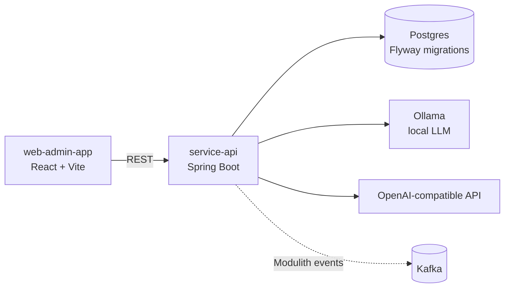

# personal-ai-agent

Personal AI agent platform: a Spring Boot backend plus a React admin UI. Built to work with the
modern Spring stack end to end — Spring AI, Spring Modulith with domain events, and
Testcontainers-backed integration tests.

**Stack** — Java 21 · Spring Boot 3.5 · Spring AI 1.0 (Ollama / OpenAI-compatible) · Spring Modulith ·
Kafka (event externalisation) · Postgres + Flyway · Resilience4j · Quartz · Spring Security ·
Testcontainers · OpenAPI · React 18 + Vite + Tailwind 4

## What's inside

`service-api` is a Spring Modulith application, split into modules rather than layers:

| Module | Responsibility |
|---|---|
| `user` | user management — entities, repository, service, REST resource |
| `quize` | quiz management and answering |
| `assistants.text` | AI text assistance (correction, translation) through the Spring AI `ChatClient` |
| `core` | shared configuration and repositories |

Domain events between modules are published through Spring Modulith and externalised to Kafka, so
modules stay decoupled instead of calling each other directly.

`web-admin-app` is the admin UI (React 18 + Vite + Tailwind 4 + Radix UI) for quizzes and users.



## Quickstart

Prerequisites: JDK 21, Node 18+, and Docker or Podman.

Start the dependencies (Postgres, Ollama, Vosk speech-to-text server):

```sh
docker compose up -d
```

Backend:

```sh
./gradlew :service-api:bootRun
```

- API base: http://localhost:8080
- API docs: http://localhost:8080/swagger-ui/index.html

Admin UI, in a second terminal:

```sh
cd web-admin-app
npm install
npm run dev
```

- Web app: http://localhost:5173

### Podman on macOS instead of Docker

```sh
export DOCKER_HOST="unix:///Users/$USER/.local/share/containers/podman/machine/podman.sock"
podman machine ssh -- systemctl --user enable --now podman.socket
podman compose --file compose.yaml up
```

## Tests

Integration tests run against real dependencies through Testcontainers (Postgres, Kafka, Ollama),
with a reusable-container configuration:

```sh
./gradlew :service-api:test
```

A running Docker or Podman socket is required.

## Notes

- Kafka is deliberately not part of `compose.yaml`: it is started by Testcontainers in tests, and
  Modulith event externalisation can be pointed at any broker.
- `service-api/README.md` and `web-admin-app/README.md` hold per-module notes.
